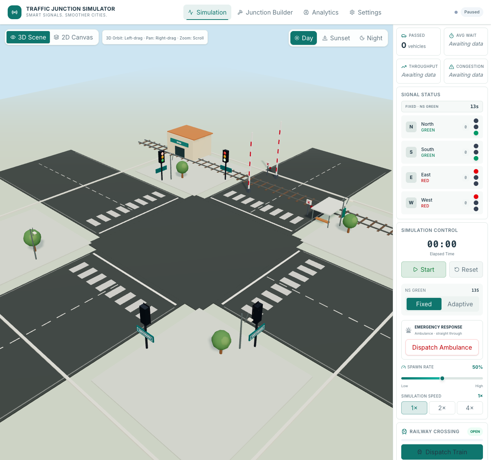
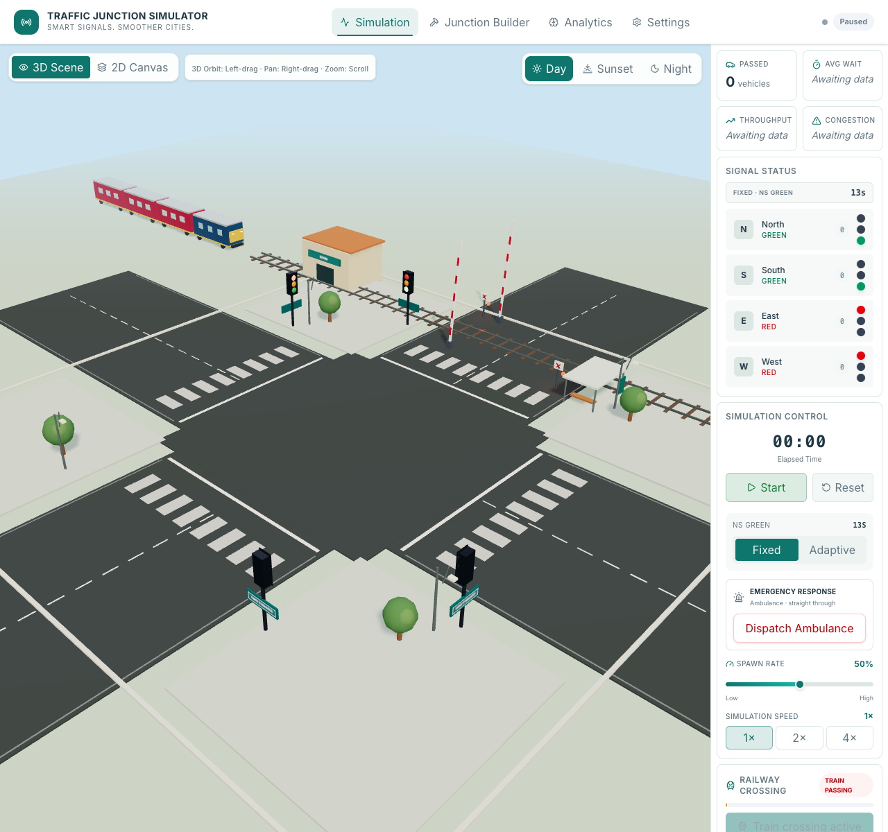

# Traffic Junction Simulator

A browser based 3D Indian traffic junction simulator built with React, Vite, and React Three Fiber. It includes a signal controlled four way junction, procedural Indian road vehicles, emergency ambulance priority, environment presets, and traffic analytics.

## Screenshots

### Junction and railway crossing



### Train approaching the crossing



## Railway crossing demo

The crossing is an independent demonstration on the north approach. It has two rails, sleepers, warning signals, animated barriers, a locomotive, and three passenger coaches. Dispatch a train from the Railway Crossing panel, or switch to automatic mode for a dispatch every 45 seconds while the crossing is open.

Sequence: **OPEN → WARNING → CLOSED → TRAIN PASSING → CLEARANCE → REOPENING → OPEN**. The train clears the road conflict zone before the clearance and reopening phases begin. Duplicate dispatches are disabled while a cycle is active.

Junction vehicles are not routed through or stopped by this separate demo crossing; their signal and emergency priority logic continues to run independently.

## Run locally

```sh
npm install
npm run dev
```

Open the local URL printed by Vite. Use the sidebar to start or pause road traffic, dispatch an ambulance or train, adjust demand and simulation speed, and switch the environment between day, sunset, and night.

## Checks

```sh
npm run build
npm run lint
```
